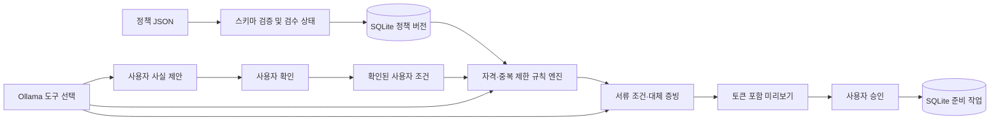

# 청년비서 — 정책 탐색·관심 저장·신청 준비 서비스

**v0.8 서비스 화면:** http://127.0.0.1:8000/ · **기존 시연/검수:** http://127.0.0.1:8000/lab

실제 수집 정책 검색 → 관심 저장 → 공식 안내 확인 → 준비 작업 미리보기/승인 → 완료/복원 → 로컬 AI 도움받기를 연결했다. 자세한 사용 흐름과 현재 범위는 [서비스 안내](SERVICE_GUIDE.md)를 참고한다. 검수 전 실제 정책에는 공식 조건을 확인할 작업을 제공하며 개인별 지원 자격을 확정하지 않는다.

## 30초 요약

**정책마다 코드를 새로 작성하지 않습니다.** `data/policies/`에 정책 1개당 JSON 파일 1개를 넣고 `python start.py`로 실행하면 DB 등록부터 정책 검색, 조건/충돌 판별, 서류 안내, 작업 미리보기, 승인 후 저장까지 자동으로 돌아갑니다.

- 판별에 사용하는 기본 정책 3개는 **가상 정책**입니다. 서울시 2026 월세지원·청년수당 2차 및 성북구 응시료 지원의 **부분 초안 3개**도 포함했으나 사람 검수 전이며 일반 판별에서 제외합니다. 해당 공고는 기간 종료 또는 조기 마감 안내 상태입니다.
- 공식 정책 초안은 검수 대기 목록에 표시하며 선택할 수 없습니다. 원문 전체 검수 후에만 `review.status: approved`, `sources[].verified: true`로 승인합니다.
- 사용자가 가진 서류를 표시해도 **서류 제출 적합** 판정이 아니며, 최종 수급 여부는 주관기관이 결정합니다.
- AI는 무료 로컬 **Ollama**를 사용합니다. 모델이 실행되지 않으면 AI 기능은 미연결로 표시됩니다. 규칙 분석·작업생성은 일반 코드이며 AI 실행으로 표시하지 않습니다. 유료 API로 자동 전환하지 않습니다.

## 실행

Python 3.10 이상 권장.

```bash
cd youth_secretary_ready
python -m pip install -r requirements.txt
python start.py
```

Windows: `run_windows.bat` / macOS 또는 Linux: `bash run_mac_linux.sh`.

브라우저 서비스: **http://127.0.0.1:8000** / 기존 6단계 검수 화면: **http://127.0.0.1:8000/lab** / API 자동 문서: **http://127.0.0.1:8000/docs**.

`start.py`는 처음 시작할 때 JSON들을 SQLite DB(`data/youth_secretary.sqlite3`)로 가져옵니다. 정책 JSON을 추가하거나 수정했다면 서버를 재시작하세요. **승인된 같은 버전 데이터를 변경하는 경우에는 기본적으로 덮어쓰지 않습니다.** 새 버전을 부여하는 것이 원칙입니다.

## 입력해야 하는 데이터 (한 정책당 JSON 1개)

1. `data/policies/_REAL_POLICY_TEMPLATE.json`을 복제해 `data/policies/seoul_policy_2026.json` 같은 새 이름으로 저장합니다. 앞에 `_`가 붙은 파일은 샘플용이며 수집 대상에서 제외됩니다.
2. 아래 항목을 공식 공고대로 입력합니다.

| 영역 | 필수 입력 | 유의사항 |
|---|---|---|
| 기본 정보 | code, name, version, agency, region, category | `code`는 영문 소문자+숫자+언더스코어만 |
| 신청 기간 | application.open, application.close | YYYY-MM-DD; 미정이면 `null`, 임의로 만들면 안 됨 |
| 출처 | sources[].ref/title/url/anchor/excerpt/verified | **실제 공식 출처만**, 인용 문구와 확인 시점 기록 |
| 신청 조건 | rules[].id/type/predicate/message/source_ref | 모든 조건에 대응되는 출처 ref 필요 |
| 서류 | documents[].code/title/issuer/constraints/instructions/source_ref | 동일 서류도 유효조건이 다르면 자동 통합하지 않음 |
| 대체서류 | documents[].alternatives[] | 적용 조건을 `when`으로 작성 |
| 검수 | review.status/reviewed_by/reviewed_at | 팀원이 공고 대조한 뒤 승인 |

3. 작성 중에는 `review.status: "draft"`를 유지합니다. 공식 원문과 대조한 뒤에만 `"approved"`로 바꾸고, 모든 출처를 `verified: true`로 표시합니다. **초안(draft)은 같은 버전으로 수정할 수 있습니다.**
4. `python start.py`로 실행하면 정책이 자동 등록됩니다.

**주의:** 이미 등록된 `code:version`의 JSON 내용을 변경하면 데이터 버전 충돌로 가져오기가 중단됩니다. `version`을 `2026.2`처럼 새 값으로 올린 뒤 재시작하세요. 급한 데모에서만 `python import_policies.py --replace`로 의도적 덮어쓰기를 할 수 있습니다.

## 정책을 추가할 때 코딩이 필요한가?

**기본 자료와 아래 규칙/필드 타입을 사용한다면 불필요합니다.**

조건 형식: `{"fact":"age","op":"between","value":[19,34]}`

지원하는 규칙 연산자: `eq`, `neq`, `in`, `not_in`, `contains`, `gte`, `lte`, `between`.

복합 조건:

```json
{"all": [
  {"fact":"region", "op":"eq", "value":"서울"},
  {"fact":"age", "op":"between", "value":[19,34]}
]}
```

**새 사용자 조건이 필요하면 코드 대신 `data/fact_definitions.json`에 항목을 추가**하세요. 예를 들어:

```json
"residence_months": {"label":"거주 개월 수","type":"integer","min":0,"max":1200}
```

새 항목은 화면에 자동으로 나타나고 정책 조건에 `"fact":"residence_months"`로 사용할 수 있습니다. 타입: `integer`, `number`, `string`, `boolean`, `enum`, `string_list`.

단, 현재 UI의 `age/region/employment_status/active_benefits/rent_payment_method/test_type`은 시연용 기본 입력으로 만들어져 있습니다. 새 조건만 동적으로 추가됩니다. **복잡한 산정식**(소득인정액, 건강보험료, 비선형 규칙), 공식 계좌/문서 진위 확인, 법적 해석은 단순 데이터만으로 안전하게 구현할 수 없습니다. 그런 조건은 `확인 필요`로 두거나 별도 검증된 코드가 필요합니다.

## 서류와 충돌의 처리 방식

- `required` 규칙: 조건에 맞지 않으면 `ineligible` / 필요한 사실이 없으면 `needs_review`.
- `exclude` 규칙: 조건에 맞으면 `ineligible`; **한 방향으로만** 적용합니다. 반대 방향 제외는 자동 추론하지 않습니다.
- 신청 기간 전후: `application_closed`. 실제 모집이 미정이라면 기간 필드를 null로 두면 규칙 엔진이 `needs_review`로 표시합니다. 기간을 모른다고 현재 모집 중이라고 말하면 안 됩니다. 따라서 실제 정책을 운영할 때는 기간 정보를 반드시 확인하세요.
- 서류 보유: `owned` / `missing` / `unknown`. `owned`는 자기 신고이며 유효성을 보장하지 않습니다.
- 대체서류: `when`이 참일 때만 적용합니다. 모호하면 확인 작업을 생성합니다.
- 동일 코드라도 **발급 제약 조건이 다르면 별개의 task_key**로 관리합니다.
- 모든 작업의 `sources`에 규칙/서류 관련 정책 출처가 연결됩니다.
- 사용자가 조건이나 선택 정책을 바꾸면 **기존 작업은 미재확인 상태**로 표시됩니다. 다시 승인한 작업은 새 정보로 갱신되며, 기존 완료 표시도 재검토를 위해 할 일로 돌아갑니다. 더 이상 필요 없는 과거 작업은 이 MVP에서 자동 삭제하지 않습니다.

## 무료 로컬 AI 실행

공식 [Ollama Windows 안내](https://docs.ollama.com/windows)와 [JSON 스키마 출력 명세](https://docs.ollama.com/capabilities/structured-outputs)를 사용합니다. 모델이 JSON으로 도구 이름·인수를 선택하고 서버가 검증한 뒤 실행합니다. 기본 native tools 경로는 이 PC의 실제 검증에서 도구를 호출하지 않아 채택하지 않았습니다. 기본 모델은 [qwen3:4b](https://ollama.com/library/qwen3:4b), 약 2.5GB, Apache-2.0입니다. 실제 RAM 사용량은 컨텍스트 및 GPU 사용에 따라 달라집니다.

이 작업 PC에는 `.local/ollama/`에 공식 CLI를, `.local/models/`에 모델을 준비합니다. 다른 PC는 공식 Ollama를 설치하거나 CLI를 같은 위치에 두세요.

Windows PowerShell:

```powershell
.\run_ollama.ps1
.\run_windows.bat
```

일반 설치를 사용하면 별도 터미널에서 `ollama serve`, `ollama pull qwen3:4b` 후 웹 서버를 시작할 수 있습니다. 모델은 최초 한 번 다운로드하며 로컬 추론에는 API 키·사용료가 없습니다. PC 전력/저장공간은 사용합니다. `run_ollama.ps1`은 로컬 모델 저장 폴더와 클라우드 비활성화 환경변수를 설정합니다. 기존 Ollama 서버가 이미 실행 중이면 그 서버의 모델 저장소를 사용합니다.

선택 환경변수: `OLLAMA_BASE_URL=http://127.0.0.1:11434`, `OLLAMA_MODEL=qwen3:4b`. 외부 호스트와 클라우드 모델은 이 앱에서 허용하지 않습니다. 키 환경변수는 사용하지 않습니다. 연결 후 화면의 **로컬 AI 연결 다시 확인** 버튼을 누르세요.

- 모델이 `update_user_facts`로 추출한 값은 **제안 상태**입니다. 사용자가 확인 버튼을 눌러야 `/facts`에 저장합니다. `expected_revision`이 다르면 409입니다.
- `analyze_selected_policies`는 기존 규칙 엔진을 실행하고 SQLite에 분석 스냅샷을 기록합니다. 제안 조건으로 계산했으면 `hypothetical=true`로 구분합니다.
- `preview_preparation_tasks`는 서류·준비판만 미리봅니다. 모델에는 준비 작업 저장 도구가 없습니다.
- 도구 호출은 최대 4회 모델 응답/총 12개 도구, 한 응답당 최대 6개. 호출당 제한 시간 90초. 시간초과 504, 미연결 503, 응답 형식/루프 실패 502. 실행 기록은 원문 메시지 대신 상태·소요시간·도구 이름을 저장합니다. JSON 형식 오류·출력 토큰 한도 도달은 실패로 처리합니다.
- AI 설명은 오류 가능성이 있습니다. 화면의 규칙 판별 결과/원문을 함께 확인하세요. 도구를 실행하지 않은 답변은 자격 판단 근거로 표시하지 않습니다.
- 가상 프로필만 사용합니다. 실제 신분증·계좌·민감정보 파일은 받지 않습니다.

## 미리보기 승인 계약 (v0.5)

기존 라우트는 유지하되 `/api/confirm`에 `preview_token`이 필요합니다. `approved=true`만 전송하는 구형 요청은 **409**입니다.

```json
{"session_id":"세션 ID", "approved":true, "preview_token":"/api/preview 응답의 preview_token"}
```

토큰에는 세션 ID·revision·입력 사실·서류 보유·선택 정책 내용·한국 날짜·접수 기간 상태를 반영합니다. 마감 정각을 지나면 같은 날이어도 이전 미리보기는 무효입니다. 서버가 트랜잭션 안에서 현재 내용을 다시 검증합니다. 미리보기와 달라지면 저장하지 않습니다. 같은 미리보기 재승인은 중복 생성하지 않습니다. 기존 DB는 `init_db()`에서 `preparation_tasks.generated_fingerprint`를 추가하며, 기존 작업은 최초 재확인이 필요합니다. stale 작업의 상태 변경은 409입니다.

모집 시각은 `open_at`/`close_at`의 시간대를 포함한 ISO 문자열로 지정할 수 있습니다. 시작 시각은 포함하고 마감 정각은 제외합니다. 시각 없이 날짜만 지정한 기존 정책은 일 단위를 유지합니다. 복잡한 소득 산정, 월 단위 인정 예외 등 표현하지 못한 조건은 `manual_checks`에 남겨 `needs_review`로 처리하세요. 일부 규칙만 통과했다고 전체 적격으로 결론 내리지 않습니다.

```json
{"manual_checks":[{"id":"reference_date", "message":"공고 기준일의 수급 종료 이력 확인 필요", "source_ref":"notice"}]}
```

## 연결 구조



## 백엔드 API

`GET /api/health` · `GET /api/fact-definitions` · `GET /api/policies` · `GET /api/policies/{code}` · `POST /api/sessions` · `PUT /api/sessions/{sid}/facts` · `PUT /api/sessions/{sid}/selected` · `PUT /api/sessions/{sid}/documents` · `POST /api/analyze` · `POST /api/preview` · `POST /api/confirm` · `GET /api/sessions/{sid}/tasks` · `PATCH /api/tasks/{id}` · `POST /api/agent/message`.

**보안:** 로그인 및 역할 기반 접근제어가 없는 **해커톤 데모 전용** 서버입니다. `127.0.0.1` 바인딩을 유지하고 인터넷에 공개 배포하거나 실제 민감한 사용자 정보를 받지 마세요. 외부 공개 전 인증, 개인정보 동의/삭제, Rate limit, 서버측 데이터 보존정책, 변경 감지 등을 구현해야 합니다.

## 테스트

```bash
python -m pip install -r requirements-dev.txt
python -X utf8 -m pytest -q
```

## 이전 PostgreSQL 설계안과 관계

앞에서 만든 16개 테이블 PostgreSQL ERD는 **확장 목표 설계**입니다. 이번 실행형 MVP는 기동과 시연을 우선해 별도 SQLite 스키마를 사용하므로, **이전 PostgreSQL schema.sql과 그대로 동일하지 않고 서로 바로 연결되는 것도 아닙니다.** 서비스 구조와 주요 개념(정책/버전/출처/규칙/서류/세션/작업/로그)은 맞춰 두었습니다. 운영 DB로 옮길 때는 별도 마이그레이션이 필요합니다.

## 추가 문서 / 변경 확인

- [기존 구현 분석과 P0 계획](IMPLEMENTATION_PLAN.md)
- [검증 결과와 시연 절차](VALIDATION.md)
- [정책 원문·검수 대기 내역](data/POLICY_REVIEW.md)
- `GET /api/policy-catalog`: 승인/초안 버전 목록 및 검수 상태
- `GET /api/sessions/{sid}/agent-runs`: 해당 세션의 모델 실행·도구 이력 (최근 20개)

원본 테스트 15개는 먼저 변경 없이 실행했습니다. 이후 저장 계약이 강화되어 기존 저장 테스트에는 미리보기 토큰 획득만 추가했습니다. AI 미설정 테스트는 Ollama 미연결을 명시적으로 대체합니다. 이 수정으로 핵심 검증 assertion을 제거하지 않았습니다.

화면은 마지막 가상 세션 ID만 브라우저 localStorage에 보관해 새로고침 후 준비판을 복원합니다. 개인정보 원문은 브라우저 저장소에 기록하지 않습니다. 새 페르소나를 선택하면 새 세션을 만듭니다.

재현 설치: `python -m pip install -r requirements-lock.txt` (검증한 Windows/Python 3.13 환경). 다른 운영체제는 일반 requirements를 사용하고 별도로 검증하세요. 브라우저 테스트: `python -X utf8 tests/browser_smoke.py` (Edge 및 실행 중인 앱 필요). 실제 모델 테스트: `python -X utf8 tests/live_agent_smoke.py`, `python -X utf8 tests/live_fact_smoke.py` (Ollama 필요).

## v0.5: 기준일·수급 이력과 검수 화면

무료 로컬 구성과 기존 저장 흐름을 유지한다. 신규 의존성 없이 Python 표준 날짜·시간 기능으로 구현했다.

```json
{
  "application": {
    "open": "2026-05-06", "close": "2026-05-19",
    "open_at": "2026-05-06T10:00:00+09:00",
    "close_at": "2026-05-19T18:00:00+09:00"
  }
}
```

시각은 둘 다 지정해야 하고, 한국시간으로 환산한 날짜가 기존 open/close와 맞아야 한다. 날짜만 전달한 과거 시뮬레이션은 시각 경계일에 `unknown`을 반환한다. 시뮬레이션 날짜를 현재 모집기간으로 사용하지 않는다.

추가 사실 타입: `date` (정확한 YYYY-MM-DD), `benefit_history` (최대 30개 수급 이력). 날짜 타입에 `between`, `gte`, `lte` 등을 적용할 수 있다.

```json
{
  "application_date": "2026-05-06",
  "benefit_history_complete": true,
  "benefit_history": [
    {"code":"seoul_youth_allowance","start":"2026-03-01","end":"2026-05-05","ongoing":false}
  ]
}
```

이력의 종료일은 **마지막 지원 대상일**이며 은행 입금일이 아니다. 위 예시는 가상 입력이고, 실제 수급 이력이나 해당 사업 전체 자격을 의미하지 않는다. `ongoing=true`는 해당 신청 기준일까지 계속 지원받았다는 명시적 확인이며 종료일과 함께 넣을 수 없다. 날짜를 모르면 null로 두며, `ongoing=false`와 종료일 null만으로 미수급을 단정하지 않는다.

```json
{"fact":"benefit_history","op":"benefit_active_on","value":{
  "code":"seoul_youth_allowance",
  "date_fact":"application_date",
  "complete_fact":"benefit_history_complete"
}}
```

- 시작·종료일 모두 포함해 기준일과 겹치면 참이다. 종료일이 기준일 전날이면 해당 기간은 겹치지 않는다.
- 관련 이력을 모두 확인했다는 값이 true일 때만 누락된 사업을 미수급으로 취급한다. 빈 목록 자체는 미수급 증거가 아니다.
- 하나라도 겹치는 이력이 확인되면 다른 이력 누락과 무관하게 해당 제외 조건은 참이다.
- 필요한 날짜가 불분명하면 확인 필요로 남긴다. 사업별 월 단위 인정, 과거 선정 이력, 미래 수급 예정, 환수 조건까지 해결하는 일반 법률 판단 엔진은 아니다.

화면의 **공식 정책 초안 → 가상 조건으로 규칙 검토하기**에서 저장한 가상 조건과 검토 시각을 넣어 분기를 확인한다. `POST /api/policy-review/preview`는 검토 결과만 반환한다. 세션·분석 기록·준비 작업을 DB에 쓰지 않으며 승인용 토큰도 없다. 실제 준비판에는 승인된 정책만 선택할 수 있다.

검수 API 요청 예:

```json
{"code":"seoul_rent_2026","version":"2026.1","facts":{"region":"서울","application_date":"2026-05-06","benefit_history_complete":true,"benefit_history":[]},"at":"2026-05-06T12:00:00+09:00"}
```

현재 공식 초안의 나머지 자격과 예외는 수동 검토 대상이다. 이 화면에서 규칙을 통과해도 `review.status`나 `verified`가 자동 승인되지 않는다. 추가 브라우저 검증은 `python -X utf8 tests/browser_review_smoke.py`로 실행한다.

## 온통청년 정책 API (v0.6)

공식 [API 안내](https://www.youthcenter.go.kr/cmnFooter/openapiIntro/oaiDoc)의 `https://www.youthcenter.go.kr/go/ythip/getPlcy`를 사용한다. 2026-11-16 실제 발급키로 인증·정책명 검색·페이지 정보·정책 필드를 확인했다. 요청은 `apiKeyNm`, `pageNum`, `pageSize`, `rtnType=json`, 선택적으로 `plcyNm`을 사용한다. 성공 응답은 `resultCode=200`, `result.pagging`의 `totCount/pageNum/pageSize`, `result.youthPolicyList`로 검증한다.

1. `.local/ontong_api_key.txt`에 발급키만 한 줄로 저장한다. 환경변수 `ONTONG_YOUTH_API_KEY`가 있으면 우선 사용한다. 서버를 재시작할 필요는 없다.
2. 화면 02의 **온통청년 API · 실제 정책 가져오기**를 연다. **연결 설정 다시 확인** 후 정책명으로 검색한다. 설정됨은 파일 확인 상태이며 실제 인증 성공은 수집 결과로 확인한다.
3. 한 번 클릭하면 첫 페이지 최대 10건을 수집한다. 검색 전체 건수와 이번 저장 건수는 다르다. 반복 클릭은 다음 페이지가 아니라 첫 페이지 재확인이다.
4. API 원문의 제출서류·조건을 열어 보고 **검토 자료 JSON 내려받기**로 검수에 사용할 수 있다. 이 JSON은 정책 가져오기 CLI에 바로 넣는 승인 정책 파일이 아니다.

CLI (명시적 실행 시에만 API 호출):

```powershell
.venv\Scripts\python.exe -X utf8 sync_ontong.py --keyword 월세 --page-size 10 --max-pages 1
```

위 검색 CLI는 한 실행당 최대 3페이지·30건이다. 주기 실행·유료 API 전환은 없다. 검색 수집 실패 시 자동 반복 호출하지 않는다. 429 한도 오류는 사용자에게 표시하며, 이후 직접 다시 시도한다. 사용자가 명시적으로 요청한 전체 수집은 아래 별도 CLI를 사용한다.

파이프라인:

```text
온통청년 HTTPS GET → 응답/페이지/필드 검증 → 공개 필드 정규화·SHA256
  → SQLite 후보 + 변경 스냅샷 + 수집 이력 (일괄 트랜잭션)
  → 원문 검토 자료 → 공식 공고 대조·규칙/서류 작성·사람 검수
  → 기존 승인 정책 JSON → 자격·중복 제한 → 서류·AI 도구 → 사용자 승인 → 준비 작업 DB
```

**API 후보와 기존 승인 정책 사이의 검수는 아직 수동 단계다.** 수집 성공을 실제 자격 판별 완성으로 표시하지 않는다. 신청기간 누락은 상시 모집으로 해석하지 않고, 사업기간을 신청기간으로 대체하지 않는다. 코드값과 부가 조건 문구로 자격·중복 수혜 규칙을 추측해서 생성하지 않는다. 수집된 API 값도 공식 모집 공고와 대조해야 한다.

- `ontong_candidates`: 정책번호별 최신 공개 데이터, 최초/최종 수집 시각, 변경 해시.
- `ontong_snapshots`: 정규화한 공개 필드 내용이 바뀔 때만 추가 저장. 기관 담당자 이름과 미지정 필드는 제외한다. 원본 HTTP 전체 응답을 저장하지 않는다.
- `ontong_sync_runs`: 검색어, 성공/실패, 저장 수, 전체 검색 수, 오류 코드. 키·키가 포함된 URL·원문 오류 응답을 저장하지 않는다.
- 후속 페이지 실패·중복 ID·페이지 불일치·DB 오류 시 해당 실행의 후보 변경을 전부 취소한다. 실패 이력만 남긴다. 검색에서 빠진 정책을 삭제된 정책으로 간주하지 않는다.
- 브라우저에는 인증키를 전달하지 않는다. 공식 고정 HTTPS 주소만 호출하고 리다이렉트는 따르지 않는다. HTTP 라이브러리의 키 포함 요청 로그도 차단한다.
- 목록 화면은 전체 DB 검색과 20건 단위 페이지 이동을 지원한다. 현재는 인증 없는 로컬 시연 앱이며 이 API를 그대로 공개 서버에 노출하지 않는다.

추가 로컬 API: `GET /api/integrations/ontong`, `POST /api/integrations/ontong/sync`, `GET /api/integrations/ontong/candidates`, `GET /api/integrations/ontong/candidates/{external_id}`.

`tests/test_ontong.py`는 외부 호출 없는 회귀 검사다. `python -X utf8 tests/browser_ontong_smoke.py`는 실행 중인 서버와 실제 키가 필요하고 **실제 API 1페이지를 호출**하는 별도 브라우저 검증이다. 키 파일과 `.local/`는 Git·공유 제출물에서 제외한다.

### 전체 정책 수집

```powershell
.venv\Scripts\python.exe -X utf8 sync_all_ontong.py
# 네트워크 중단 후 기존 페이지를 이어받을 때만:
.venv\Scripts\python.exe -X utf8 sync_all_ontong.py --resume
```

검색어 없이 API가 반환하는 전체 목록을 100건씩 순차 수집한다. `.local/ontong-full-checkpoint.json`에 완료한 페이지와 검증된 공개 필드를 저장한다. 페이지별 전체 건수 일치, 정책번호 중복 없음, 마지막 페이지 수량, 종료 시 첫 페이지 재확인을 통과하면 한 DB 트랜잭션으로 후보와 변경 이력을 반영한다. 실패 시 기존 후보를 유지하며 수집 이력과 체크포인트로 중단 위치를 확인할 수 있다. 첫 페이지가 바뀌거나 전체 건수가 변하면 새 수집이 필요하다.

네트워크/서버 오류만 최대 3회 시도하며 짧은 대기를 둔다. 인증·호출 한도·응답 구조 오류는 자동 재시도하지 않는다. 웹 화면 로드로 전체 수집이 시작되지 않는다. API가 일관된 스냅샷 토큰을 제공하지 않으므로, 모든 내용을 정확히 같은 시각에 읽었다고 보장하지 않는다. 이전에 저장했지만 이번 목록에 없는 후보도 임의 삭제하지 않는다.

전체 수집은 정책 API가 제공하는 목록 범위이며, 모든 지자체 정책의 존재나 원문 첨부파일까지 수집했다는 뜻이 아니다. 검수 전 상태는 동일하게 유지한다. 전체 수집 결과는 DB·내보낸 JSON·화면의 전체 정책 검색으로 확인한다.

## v0.7: 전체 검색 → 원문 대조 → 규칙·서류 검토

화면 02에서 온통청년 영역을 열고 **저장된 전체 정책 검색**을 사용한다. 정책명·기관·정책번호, API 분야, 신청기간/서류/링크 미기재 필터를 조합할 수 있다. 검색과 페이지 이동은 SQLite 읽기만 수행하며 외부 API를 재호출하지 않는다. `GET /api/integrations/ontong/search`의 q/category/quality/page/page_size를 사용한다. 이전 `/candidates` 목록 API는 호환성을 위해 최근 100건 반환을 유지한다.

원문 대조한 정책 3건은 `data/source_checks.json`으로 API 정책번호와 기존 규칙 초안을 연결했다. **대조한 범위, 확인일, 원문 링크, API 기간과 공식 기간의 차이**를 함께 표시한다. 수집 원문의 해시가 바뀌면 ‘API 변경됨 · 재대조 필요’가 표시된다. API 내용이 변하지 않았더라도 공식 사이트가 바뀔 수 있으므로 확인일 이후의 유효성을 보증하지 않는다. 대조 기록은 전체 자격 승인과 별개다.

- 서울 청년월세: API의 연간 기간과 공식 모집 접수기간 차이 표시.
- 서울 청년수당 추가 2차: 날짜 일치 및 공식 마감 시각 보완 표시.
- 성북구 응시료 지원: 공식 페이지의 예산 소진 조기 마감 표시. 새 초안 4개 규칙·8개 서류 항목과 수동 확인 사항 입력. 8개는 조건부를 포함한 항목 수이며 모두에게 8개 제출을 요구한다는 뜻이 아니다.

**연결된 규칙·서류 초안 검토**를 누르면 해당 검수 카드로 이동한다. 서류의 발급 조건과 유의사항, 가상 조건에 따른 규칙 결과 및 준비 작업 제안을 확인할 수 있다. 검토 결과는 저장되지 않으며 정책을 자동 승인하지 않는다.

조기 마감 표현:

```json
"closure_notice": {
  "observed_on": "2026-11-16",
  "source_ref": "notice",
  "reason": "공식 안내에서 예산 소진 조기 마감을 확인했습니다."
}
```

이 값은 application 안에 둔다. `observed_on`은 마감을 확인한 날이고 정확한 종료 발생일이 아니다. 확인일 이후는 해당 공고를 `closed`로 처리하고, 확인 전의 원래 모집기간 안에서는 `unknown`으로 남긴다. 과거 시뮬레이션을 접수 가능의 증거로 쓰지 않는다. 출처 참조·날짜·사유를 검증하며, 종료된 공고의 준비판은 차기 공식 공고 확인만 제안한다.

성북구 초안은 거주 자치구·계속 거주 시작일·사업자등록 여부를 추가 입력받는다. 연령 기준, 근로 예외, 인정 시험, 수혜 한도/중복 관계, 월별 접수 창 등은 수동 확인 사항으로 유지한다. 현재 입력한 일부 규칙 통과로 전체 자격을 확정하지 않는다.
